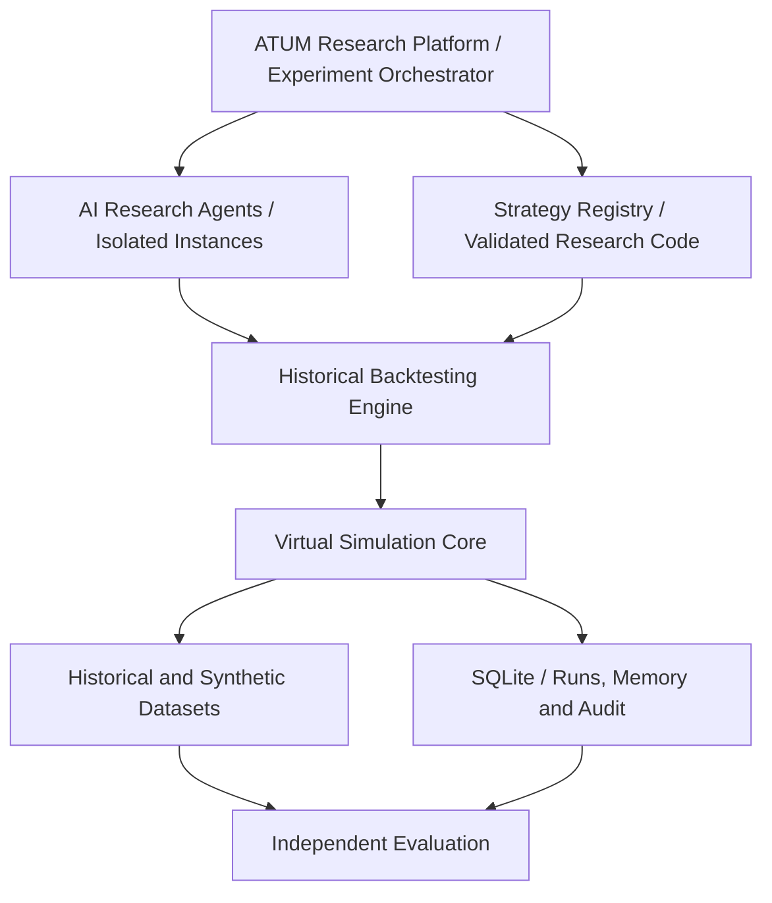

# 𓀭 ATUM — Research & Engineering Development Proposal

**AI Market Simulation & Strategy Research Framework**

**Document:** ATUM-RD-001  
**Repository:** https://github.com/Lord1Egypt/atum  
**Reference:** https://github.com/FindDataTechnology/fd-paper-trading  
**Status:** Research and Engineering Proposal

---

## 1. Executive Summary

ATUM must evolve into a professional, scientifically verifiable AI market simulation and algorithmic strategy research platform.

The objective is not to accumulate features, indicators, or AI integrations without demonstrating their correctness. The objective is to construct a reliable experimental environment in which artificial agents and algorithmic strategies can be evaluated under controlled, reproducible conditions.

All development and validation under this proposal must use historical or synthetic market data, virtual accounts, and simulated execution. Real-money execution, broker credentials, and autonomous live trading are outside the scope.

## 2. Engineering Principles

- Correctness before feature expansion.
- Evidence before performance claims.
- Reproducibility before optimization.
- Preserve the existing architecture where technically appropriate.
- Prefer independent, testable components.
- No fabricated results or silently ignored errors.
- No cherry-picking successful experiments.
- Preserve and document negative research results.
- No claims of real-world profitability based on simulated performance.
- Fail closed when simulation assumptions or experimental inputs are invalid.

## 3. Comparative Research: ATUM vs. FD

ATUM currently offers a broader AI-oriented architecture, including:

- Go execution architecture.
- SQLite local storage.
- Native LLM integration.
- Agent tool calling.
- Five-layer memory architecture.
- Specialized sub-agents.
- External MCP integration.
- Event bus and observability.
- Backtesting and strategy comparison components.
- A library of 4,405 strategy and indicator files collected from 433 repositories.

FD demonstrates useful architectural approaches in:

- Multi-user authentication.
- Independent virtual accounts.
- Account ledger persistence.
- Decimal-based financial calculations.
- Order lifecycle management.
- Pending order handling.
- Market data abstraction.
- REST and MCP server interfaces.
- Account isolation tests.
- Financial invariant testing.
- End-to-end validation.

FD must be studied as a technical reference, not assumed to be a fully realistic market simulator.

Do not replace ATUM's existing architecture merely to reproduce FD functionality.

## 4. Critical Findings Requiring Investigation

The preliminary static source review identified the following issues.

| ID | Finding | Priority |
|---|---|---|
| ATUM-001 | Simulated selling can credit balances without sufficient existing holdings | Critical |
| ATUM-002 | Limit-order behavior is declared but not correctly implemented in the reviewed simulation adapter | High |
| ATUM-003 | Identical bid and ask prices eliminate spread in the current simulation | High |
| ATUM-004 | Simulation adapter and backtesting engine apply inconsistent execution assumptions | High |
| ATUM-005 | Account state in the simulation adapter is primarily in-memory | High |
| ATUM-006 | Float64 is used for financial state and calculations | High |
| ATUM-007 | Account-level and agent-level isolation remain unverified | High |
| ATUM-008 | API authentication enforcement was not evident in the reviewed server initialization | High |
| ATUM-009 | Broad CORS configuration requires review | High |
| ATUM-010 | Simulation clock and deterministic replay require validation | High |
| ATUM-011 | Support for independent concurrent research agents remains unverified | High |
| ATUM-012 | Strategy library licensing, correctness and runtime compatibility require systematic validation | High |

Each finding must be independently reproduced, classified and documented before remediation. Findings that cannot be reproduced must be explicitly marked as such.

### Review evidence and limitations

The comparison was based on static inspection of both default branches; no tests, builds, runtime experiments, or benchmarks were executed. The reported findings are not a comprehensive security audit.

- [ATUM simulation adapter](https://github.com/Lord1Egypt/atum/blob/main/internal/adapter/simulation/simulation.go)
- [ATUM simulation tests](https://github.com/Lord1Egypt/atum/blob/main/internal/adapter/simulation/simulation_test.go)
- [ATUM backtesting engine](https://github.com/Lord1Egypt/atum/blob/main/internal/backtest/engine.go)
- [ATUM API server](https://github.com/Lord1Egypt/atum/blob/main/internal/api/server.go)
- [ATUM agent runtime](https://github.com/Lord1Egypt/atum/blob/main/internal/agent/agent.go)
- [FD fill calculator](https://github.com/FindDataTechnology/fd-paper-trading/blob/main/src/fd_paper_trading/execution/fill_engine.py)
- [FD account isolation tests](https://github.com/FindDataTechnology/fd-paper-trading/blob/main/tests/e2e/test_isolation.py)
- [FD simulation profiles](https://github.com/FindDataTechnology/fd-paper-trading/blob/main/src/fd_paper_trading/strategy/simulation_profile.py)
- [FD CI](https://github.com/FindDataTechnology/fd-paper-trading/blob/main/.github/workflows/ci.yml)

FD has explicit limitations of its own: the reviewed fill calculator does not model order queues, partial fills, or price movement, and its simplified stop execution is not proof of real-market fidelity. Its CI also depends on the separate fd-quant project. The observed test-file counts (ATUM: 77; FD: 104) reflect naming-pattern matches, not test execution or coverage.

## 5. Target Research Architecture

Maintain a modular architecture consisting of:

1. Market Data and Dataset Layer.
2. Deterministic Simulation Environment.
3. Virtual Account and Accounting Layer.
4. Strategy Registry and Runtime.
5. Historical Backtesting Engine.
6. AI Agent Research Runtime.
7. Experimental Orchestration Layer.
8. Independent Evaluation and Validation Engine.
9. Audit and Observability Layer.
10. Research Dashboard.

Historical replay and virtual market simulation should use consistent, documented assumptions wherever their results are intended to be compared.

This diagram describes the proposed target, not a claim that all components are currently implemented.

## 6. Simulation Integrity

The virtual simulation environment must be independently auditable.

Research requirements:

- Explicit virtual account ownership.
- Financial conservation invariants.
- Validated numerical precision.
- Persistent experimental state.
- Deterministic event processing.
- Explicit simulation clocks.
- Invalid-input rejection.
- Documented transaction semantics.
- Reproducible synthetic market scenarios.
- Separation between simulated and externally observed data.
- No connection between experimental accounts and real capital.

Investigate the feasibility of a shared simulation contract for the backtesting and virtual execution components.

Document all simplifications and unsupported market behaviors. A simplified model must never be represented as a realistic reproduction of actual markets.

## 7. Professional Strategy Backtesting System

ATUM requires a dedicated scientific backtesting subsystem rather than a collection of loosely connected strategy implementations.

### 7.1 Strategy Registry

Establish a versioned registry for experimental strategies containing:

- Unique strategy identifier.
- Source and attribution.
- License information.
- Implementation language.
- Runtime compatibility.
- Required input data.
- Declared parameters.
- Version and content fingerprint.
- Validation status.
- Known limitations.
- Historical experiment references.

Imported strategy files must be treated as untrusted research material, not validated algorithms.

### 7.2 Strategy Library Audit

The existing library must undergo systematic inspection.

Classify each entry as:

- Verified compatible.
- Requires adaptation.
- Unsupported runtime.
- Duplicate.
- License restricted or unclear.
- Invalid implementation.
- Unverified.

Preserve original attribution and license requirements. Do not execute arbitrary imported source code outside an isolated research environment.

### 7.3 Backtesting Execution Contract

Every historical experiment must record:

- Strategy version.
- Dataset version and checksum.
- Experimental configuration.
- Simulation assumptions.
- Starting virtual state.
- Random seed where applicable.
- Runtime version.
- Results and diagnostics.

Identical deterministic inputs must produce reproducible outputs.

### 7.4 Scientific Validation

Investigate and test for:

- Look-ahead bias.
- Future-data leakage.
- Survivorship bias.
- Overfitting.
- Selection bias.
- Missing historical observations.
- Timestamp inconsistencies.
- Duplicate observations.
- Numerical instability.
- Unrealistic simulation assumptions.

Maintain separate development and independent evaluation datasets.

Historical experiments must be interpreted as research results, not predictions or promises of future financial performance.

### 7.5 Experimental Evaluation

The evaluation subsystem must support descriptive analysis of virtual experiments, including:

- Virtual account history.
- Equity curve visualization.
- Drawdown measurements.
- Return distributions.
- Variability across repeated experiments.
- Comparison with simple reference baselines.
- Sensitivity to experimental assumptions.
- Failed and incomplete experiments.
- Computational resource usage.

Evaluation reports must disclose uncertainty and limitations alongside results.

### 7.6 Batch Research

Support controlled batch experiments across registered strategies and historical or synthetic datasets.

Required engineering properties:

- Bounded worker concurrency.
- Cancellation.
- Progress reporting.
- Resource limits.
- Failure isolation.
- Experiment manifests.
- Result persistence.
- Duplicate-run detection.
- Consistent evaluation criteria.
- Exportable research reports.

The objective is scientific comparison and software validation, not the automatic selection of strategies for real-money trading.

## 8. Multi-Agent Research Arena

ATUM should provide an isolated environment for evaluating multiple artificial agents.

Initial research target: ten independent agent instances.

Each instance should have independently identifiable:

- Configuration.
- Virtual account.
- Memory namespace.
- Model identity.
- Experimental session.
- Event history.
- Resource usage.
- Evaluation results.

All agents participating in a comparative experiment must receive equivalent experimental conditions.

Measure agent behavior, reproducibility, computational overhead, tool reliability and consistency. Model outputs must not bypass experimental safety boundaries.

## 9. Data Engineering

Implement a research-oriented data management subsystem.

Investigate:

- Immutable datasets.
- Historical data normalization.
- Synthetic dataset generation.
- Data provenance.
- Timestamp normalization.
- Dataset integrity checks.
- Dataset versioning.
- Missing-data reporting.
- Storage efficiency.
- Replay consistency.

Clearly distinguish historical observations, synthetic observations and derived values.

Respect third-party data licenses.

## 10. Security and Isolation

Conduct a professional security review covering:

- Authentication and authorization.
- API access boundaries.
- Virtual account isolation.
- Agent memory isolation.
- Untrusted strategy execution.
- Filesystem permissions.
- Dependency security.
- Secret handling.
- Resource exhaustion.
- Audit logging.
- Local-only default network binding.

The research deployment must not expose real-money execution capabilities.

Security-sensitive behavior must be tested rather than assumed from the presence of security-related modules.

## 11. Professional Research Dashboard

The dashboard should expose:

- Experiment overview.
- Virtual account state.
- Agent status.
- Strategy registry.
- Historical experiment configuration.
- Backtesting progress.
- Historical results.
- Dataset provenance.
- Comparative research visualizations.
- System resource consumption.
- Validation status.
- Failed experiments and diagnostic reports.

Every displayed result must be traceable to an identifiable experimental run.

## 12. Performance Engineering

Measure actual resource consumption instead of assuming that Go or SQLite automatically provide superior performance.

Benchmark:

- Startup time.
- Idle memory.
- CPU utilization.
- Database growth.
- Historical replay throughput.
- Concurrent experimental workload.
- Event processing throughput.
- API latency.
- Long-duration stability.

Target platforms:

- Linux AMD64.
- Linux ARM64.
- Windows.
- Resource-constrained local environments.

All benchmark reports must identify hardware, software versions, workload, configuration and measurement methodology.

## 13. Quality Assurance

Establish a comprehensive validation pipeline.

Required test categories:

- Unit tests.
- Integration tests.
- End-to-end tests.
- Property-based tests.
- Financial invariant tests.
- Deterministic replay tests.
- Concurrency tests.
- Race detection.
- Account isolation tests.
- Data integrity tests.
- Security regression tests.
- Recovery and persistence tests.
- Backtesting correctness tests.
- Cross-platform build tests.
- Long-duration stability tests.

Passing a test suite alone must not be interpreted as proof of market realism or predictive capability.

## 14. Research Roadmap

| Phase | Objective |
|---|---|
| Phase 0 | Complete repository audit and establish baseline evidence |
| Phase 1 | Correct critical simulation and accounting defects |
| Phase 2 | Validate historical data and deterministic replay infrastructure |
| Phase 3 | Establish the professional strategy registry and backtesting subsystem |
| Phase 4 | Validate isolated multi-agent research sessions |
| Phase 5 | Expand reproducible experimental evaluation |
| Phase 6 | Validate security, performance and resource efficiency |
| Phase 7 | Complete documentation and research release assessment |

Every phase requires measurable acceptance criteria. Do not declare a phase complete solely because its implementation exists.

## 15. Required Deliverables

Produce and maintain:

- `REPOSITORY-AUDIT.md`
- `ARCHITECTURE-REVIEW.md`
- `FD-COMPARATIVE-ANALYSIS.md`
- `SIMULATION-INTEGRITY.md`
- `STRATEGY-LIBRARY-AUDIT.md`
- `BACKTESTING-METHODOLOGY.md`
- `DATA-PROVENANCE.md`
- `MULTI-AGENT-VALIDATION.md`
- `SECURITY-AUDIT.md`
- `BENCHMARK-REPORT.md`
- `TEST-EVIDENCE.md`
- `KNOWN-LIMITATIONS.md`
- `FINAL-RESEARCH-REPORT.md`

Include source references, test logs, experiment manifests, version identifiers and artifact hashes wherever appropriate.

## 16. Acceptance Criteria

ATUM must not be declared research-ready until:

- All critical correctness defects are resolved.
- Virtual accounting invariants are independently verified.
- Research account isolation is demonstrated.
- Historical experiments are reproducible.
- Backtesting assumptions are documented.
- Imported strategy code is properly classified.
- Experimental results are traceable.
- Security and performance limitations are disclosed.
- Supported configurations pass documented validation gates.

## 17. Final Research Verdict

The final verdict must be one of:

- RESEARCH READY
- RESEARCH READY WITH LIMITATIONS
- NOT RESEARCH READY

The verdict must follow the evidence rather than the original expectations.

ATUM's success must be measured by scientific integrity, engineering correctness, reproducibility and research value — not by feature count or simulated profits.

**Virtual Markets. Artificial Agents. Measurable Intelligence.**
